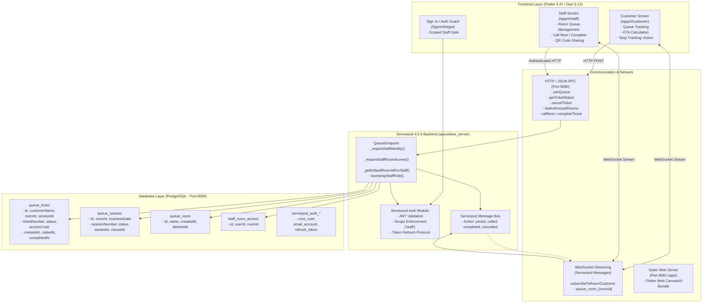
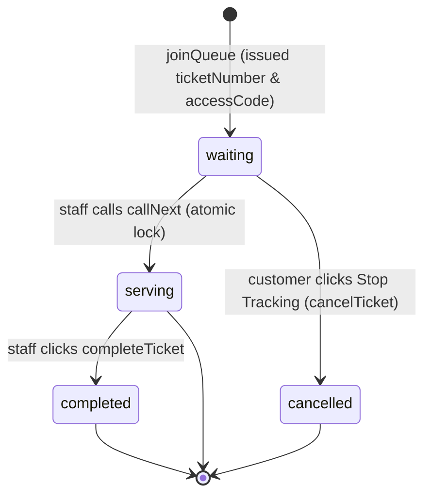

# QueueLess — Architecture & Technical Specifications

This document describes the concrete system architecture and runtime patterns implemented in the QueueLess codebase.

---

## Architecture Overview

QueueLess is a full-stack, real-time queue management system built using **Flutter Web**, **Serverpod 4.0.4**, and **PostgreSQL**.

---

## 1. Frontend Layer (`queueless_flutter`)

- **Framework:** Flutter 3.47.7 (Web target with CanvasKit rendering).
- **Entry Point & Routing:**
  - Base href: `/app/`
  - Routes: `#/customer` (customer queue registration & tracking), `#/staff` (authenticated staff dashboard).
- **State Management & Live Streams:**
  - `CustomerScreen`: Subscribes to `client.queue.subscribeToRoomCustomer(roomId, ticketId, accessCode)`. Updates live positions, status badges, and estimated waiting time.
  - `StaffScreen`: Subscribes to room events and triggers reloads of active queue (`client.queue.getActiveQueue(roomId: selectedRoomId)`).
  - Proactive token renewal: 5-minute timer invokes `client.auth.refreshAuthKey(force: true)`.

---

## 2. Serverpod Backend & Endpoints (`queueless_server`)

### Core Endpoint: `QueueEndpoint`

| Endpoint Method | Auth Required | Scope | Purpose |
| :--- | :--- | :--- | :--- |
| `bootstrapStaffRole` | Yes | Any authenticated | Grants `staff` scope to user record idempotently. |
| `listRooms` | No | Public | Returns all visible queue rooms. |
| `listAuthorizedRooms` | Yes | `staff` | Returns only rooms mapped to current user in `staff_room_access`. |
| `createRoom` | Yes | `staff` | Creates room and inserts creator mapping in `staff_room_access` in single transaction. |
| `joinQueue` | No | Public | Atomically increments ticket number for room and issues secret `accessCode`. |
| `getTicketStatus` | No | Valid `accessCode` | Returns position, total waiting, and calculated ETA. |
| `cancelTicket` | No | Valid `accessCode` | Transitions waiting ticket to `cancelled` and broadcasts event. |
| `getActiveQueue` | Yes | `staff` + room access | Returns active waiting and serving tickets (with `accessCode` sanitized). |
| `getActiveSession` | No | Public | Returns active session for room, triggering automatic daily rollover if date changed. |
| `callNext` | Yes | `staff` + room access | Atomically changes next waiting ticket to `serving` using `skipLocked`. |
| `completeTicket` | Yes | `staff` + room access | Sets serving ticket to `completed` with timestamp. |
| `restartQueue` | Yes | `staff` + room access | Closes active session/tickets and atomically starts a new session at #1. |
| `deleteRoom` | Yes | `staff` + room access | Soft-deletes room (`deletedAt`), closes active session/tickets, preserving history. |

---

## 3. Database Schema & Ticket Lifecycle

### Ticket States

### Table Definitions:
1. **`queue_room`**:
   - `id`: Primary key (autoincrement).
   - `name`: String (room display name).
   - `createdAt`: DateTime creation timestamp.
   - `deletedAt`: Optional DateTime soft-delete timestamp.
2. **`queue_session`**:
   - `id`: Primary key (autoincrement).
   - `roomId`: Foreign key to `queue_room`.
   - `businessDate`: String date (`'YYYY-MM-DD'` in Asia/Kolkata).
   - `sessionNumber`: Monotonically increasing session counter per room.
   - `status`: String enum (`'active'`, `'closed'`).
   - `startedAt`, `closedAt`: DateTime session boundary timestamps.
3. **`queue_ticket`**:
   - `id`: Primary key (autoincrement).
   - `roomId`: Foreign key to `queue_room`.
   - `sessionId`: Optional foreign key to `queue_session`.
   - `customerName`: String (trimmed, non-empty).
   - `ticketNumber`: Monotonically increasing integer per session.
   - `status`: String enum (`'waiting'`, `'serving'`, `'completed'`, `'cancelled'`).
   - `accessCode`: 6-character cryptographic alphanumeric string verifying ticket ownership.
   - `createdAt`, `calledAt`, `completedAt`: DateTime audit timestamps.
4. **`staff_room_access`**:
   - `userId`: String (Auth user UUID).
   - `roomId`: Integer (FK to `queue_room`).
   - Ensures strict tenant room isolation.

---

## 4. Room Authorization & Isolation Boundary

- **Identity Resolution:**
  `_requireStaffIdentity(session, endpointName)` verifies that `session.authenticated` is non-null and possesses the `staff` scope.
- **Room Access Guard:**
  `_requireStaffRoomAccess(session, roomId, endpointName)` verifies that a record exists in `staff_room_access` matching `(userId, roomId)`.
  If access is not found, a `QueueException('Unauthorized: You do not have permission to manage this room.')` is thrown.
- **Default Room Resolution:**
  If `roomId` is omitted in staff calls, `_getDefaultRoomIdForStaff(session, staffUserId)` retrieves the user's authorized room, preventing unintended cross-room leakage.

---

## 5. Real-Time Event & Notification Flow

- Whenever queue transitions occur (`joined`, `called`, `completed`, `cancelled`), `QueueEndpoint` broadcasts to `session.messages.postMessage('queue_room_$roomId', QueueEvent(...))`.
- WebSockets relay the event to connected staff and customer clients.
- Customer clients checking their ticket match `ticketId` against the called ticket and trigger high-visibility notification cards ("It’s your turn") accompanied by visual and auditory cues.
